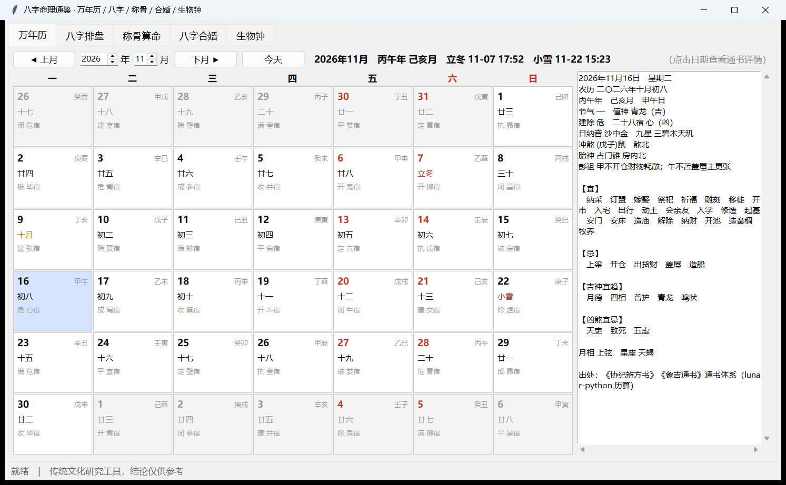
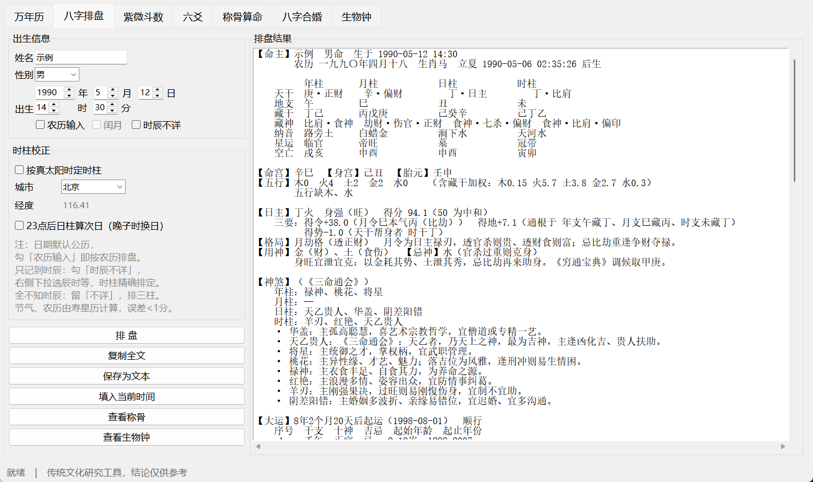
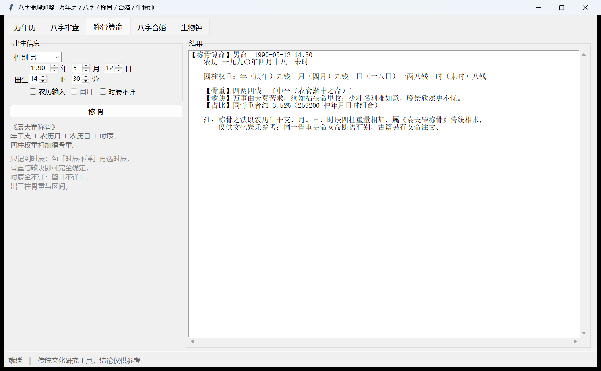
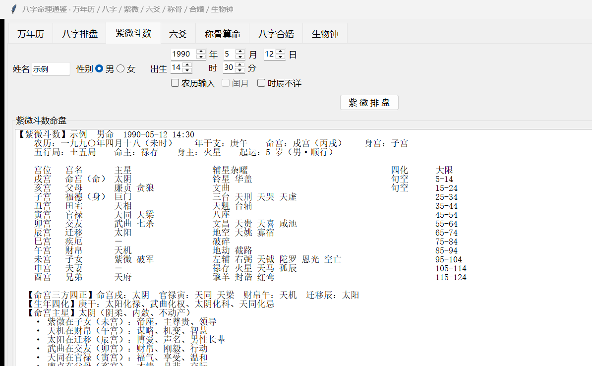
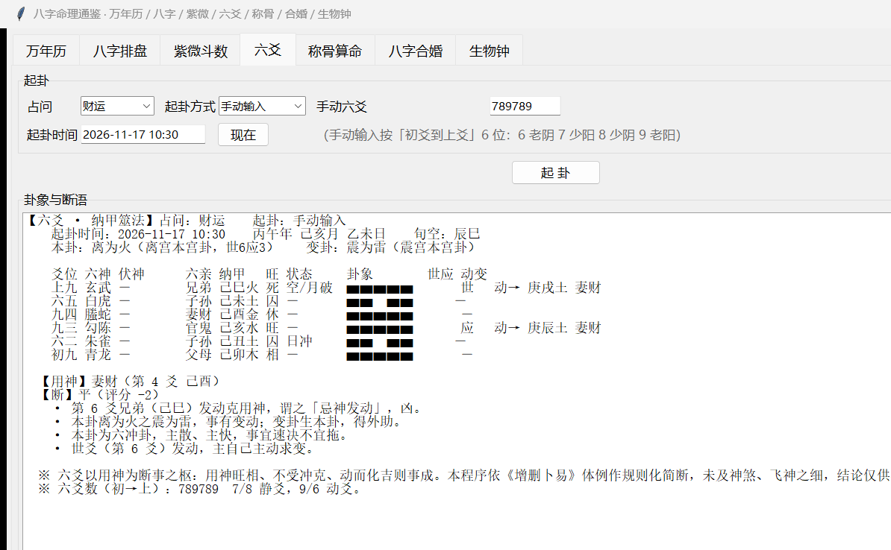
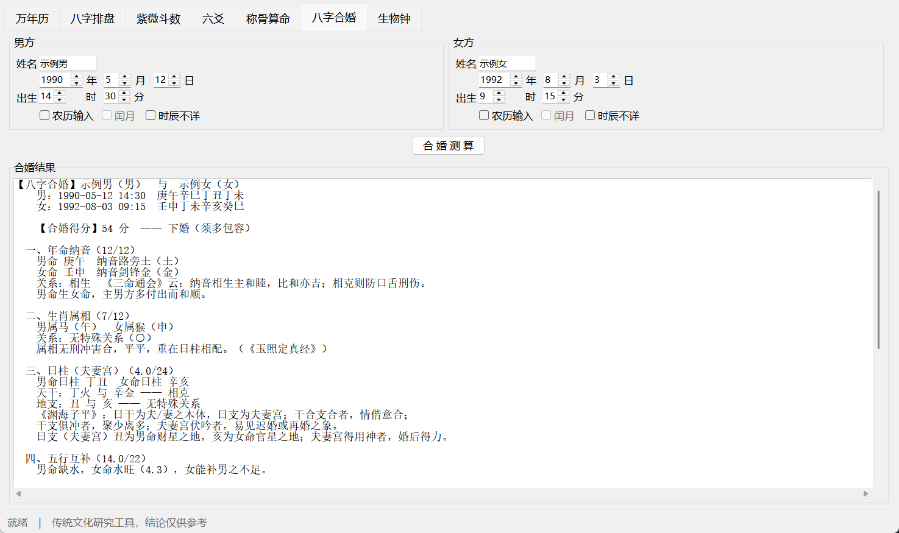
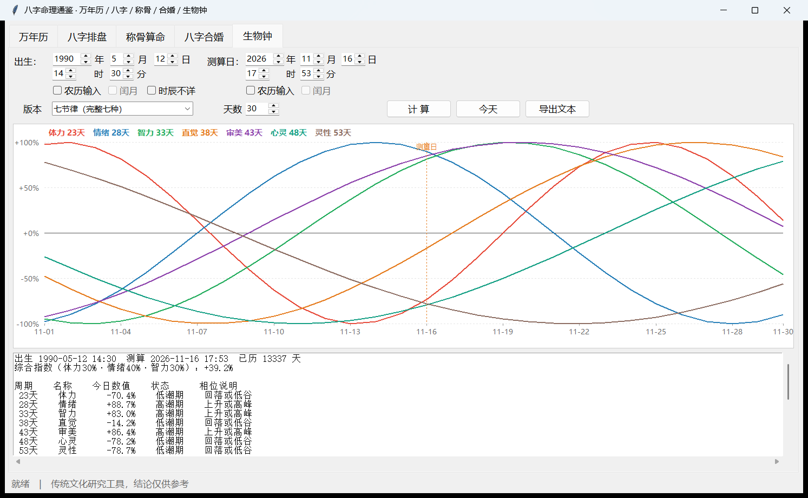
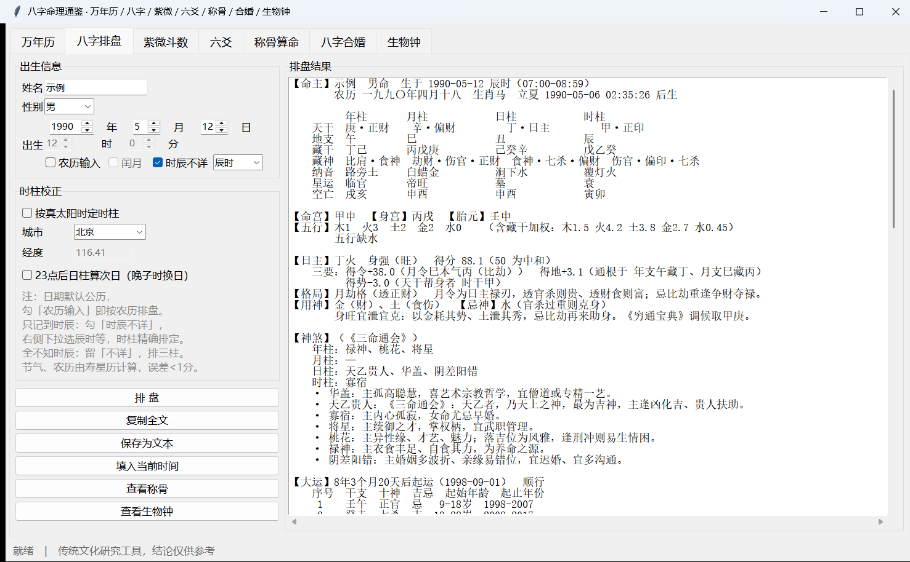
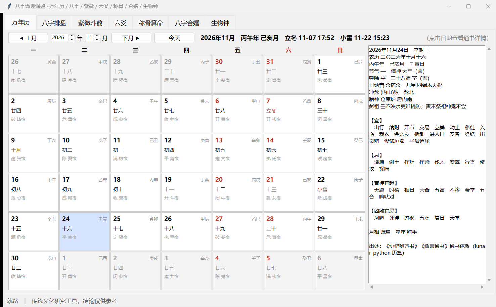

# 八字命理通鉴

万年历 · 八字排盘 · 紫微斗数 · 六爻 · 称骨算命 · 八字合婚 · 七种生物钟，七合一桌面软件。
纯 Python + tkinter，无前端依赖，Windows / macOS / Linux 均可运行。

> 仓库：<https://github.com/dbnody/bazi>
> 直接下载可执行文件：[dist/八字命理通鉴.exe](dist/八字命理通鉴.exe)（12 MB，Windows，免安装）
> 便携版：[dist/八字命理通鉴-便携版.zip](dist/八字命理通鉴-便携版.zip)（12 MB 压缩包，解压即用）



| 八字排盘 | 称骨算命 |
| --- | --- |
|  |  |

| 紫微斗数 | 六爻 |
| --- | --- |
|  |  |

| 八字合婚 | 生物钟 |
| --- | --- |
|  |  |

只记到时辰（如「辰时」）也能全功能排盘，时柱照样精确：



## 一、快速开始

**免安装（推荐给普通用户）**：双击 `八字命理通鉴.exe` 即可，无需 Python 环境。

| 产物 | 大小 | 说明 |
| --- | --- | --- |
| [`dist\八字命理通鉴.exe`](dist/八字命理通鉴.exe) | 约 12 MB | 单文件，双击即用；每次启动解压到临时目录，首次约 1.5 秒 |
| [`dist\八字命理通鉴-便携版.zip`](dist/八字命理通鉴-便携版.zip) | 约 12 MB | 解压后运行文件夹内的 exe，启动更快；**若系统禁止写入 %TEMP%（企业电脑常见），用这个** |

**从源码运行 / 重新打包**：

```bash
pip install -r requirements.txt     # 仅一个依赖：lunar-python（历算内核，纯 Python）
python main.py                      # 或双击 run.bat（Windows）
python tests/test_core.py           # 自检 115 项（历法/四柱/旺衰/紫微/六爻/称骨/合婚/生物钟）
build_exe.bat                       # 需要 PyInstaller（脚本会自动安装），产出上面两个包
```

Python ≥ 3.9（已在 3.14 验证），tkinter 随官方安装包自带。

打包命令等价于（图标见 `assets/app.ico`，太极）：

```bat
python -m PyInstaller --onefile --windowed --name BaziSuite --icon assets\app.ico --paths . main.py
python -m PyInstaller --onedir  --windowed --name BaziSuite --icon assets\app.ico --paths . --distpath dist-portable main.py
```

exe 已内嵌 `lunar-python` 与 tcl/tk，不读取任何外部数据文件；`print` 已改为弹窗报错，无控制台也能看到崩溃原因。



## 二、七大功能

| 页签 | 内容 |
| --- | --- |
| **万年历** | 公历/农历对照、年月日时干支、二十四节气（精确到分）、建除十二神、二十八宿、值神吉凶、宜忌、冲煞、胎神、彭祖百忌、吉神凶煞、九星、二十八宿、节日时令（数九/三伏）、月相、星座；点击任意日期看通书详情 |
| **八字排盘** | 四柱天干地支、十神、藏干、藏神、纳音、星运（十二长生）、空亡、命宫/身宫/胎元、五行统计（含藏干加权）、日主旺衰、格局、用神忌神、调候用神、神煞、大运（起运时刻、顺逆、逐运吉忌）、当年流年；**时辰只记到某时辰（如辰时）也能完整排盘**，完全不知时辰则按三柱盘（时柱留空、旺衰神煞不计时柱） |
| **紫微斗数** | 十二宫（命/兄弟/夫妻/子女/财帛/疾厄/迁移/交友/官禄/田宅/福德/父母）、宫干、五行局、命主身主、十四主星与三十余辅星杂曜、生年四化（禄权科忌）、大限（起运岁 + 阳男阴女顺行/阴男阳女逆行）、命宫三方四正与各星落宫释义；闰月、晚子时按通行取法处理 |
| **六爻** | 摇钱起卦 / 时间起卦（梅花易数）/ 手动输入六爻；京房八宫定卦、纳甲、六亲、六神、世应、旬空、月破、日冲、旺相休囚死；自动取用神（《增删卜易》分类）、伏神、动爻变爻、回头生克、六冲六合，给出评分与逐条断语 |
| **称骨算命** | 袁天罡称骨：年干支/农历月/农历日/时辰四柱权重相加，2 两 1 钱 ~ 7 两 1 钱共 51 等，含完整歌诀、命格评语，并给出「同骨重者占比」（枚举 259200 种组合的分布）；**只选时辰即得完整骨重与歌诀**，时辰全不详则给三柱骨重与区间（+6钱 ~ +1两6钱） |
| **八字合婚** | 六维评分（满分 100）：年命纳音 15、生肖合冲 15、日柱干支 25、五行互补 25、夫妻星 10、夫妻宫 10，逐项给出判语与化解建议 |
| **生物钟** | 七种节律曲线：体力 23、情绪 28、智力 33、直觉 38、审美 43、心灵 48、灵性 53 天；可切换「经典三节律 / 五节律 / 七节律」三种版本，任意区间曲线图、高潮/低潮/临界判定、临界日列表、综合指数 |

辅助功能：**公历/农历任选录入**（默认公历，勾「农历输入」即按农历排盘，闰月另勾「闰月」）、**时辰不详开关 + 十二时辰下拉**（八字/称骨/合婚/生物钟四处均支持：选具体时辰即精确排定，留「不详」才降为三柱；紫微斗数安命身宫必须有时辰，只记到时辰亦可）、真太阳时定时柱（内置 48 城市经度）、晚子时换日开关、一键跳转称骨/生物钟、复制与导出文本。

## 三、准确率来自哪里

历算内核采用 `lunar-python`（寿星天文历算法），节气时刻精确到**分**，农历与《中国天文年历》《紫金山天文台历书》一致；四柱的年柱以**立春交接时刻**换年、月柱以**交节时刻**换月，二十三/二十四点与子时换日按流派可选。

命理推演部分按经典取法实现：

| 内容 | 依据 |
| --- | --- |
| 十神、六亲、格局总纲 | 《渊海子平》 |
| 月令取格、成败救应 | 《子平真诠》 |
| 旺衰气势、寒暖燥湿 | 《滴天髓》 |
| 调候用神（10 日干 × 12 月令） | 《穷通宝典》 |
| 神煞、纳音、合婚 | 《三命通会》 |
| 建除、宜忌、二十八宿 | 《协纪辨方书》《象吉通书》 |
| 称骨轻重与歌诀 | 《袁天罡称骨》通行本 |
| 紫微星、天府星系、辅星杂曜、四化、大限 | 《紫微斗数全书》《紫微斗数全集》，并与 npm iztro 官方实现逐项交叉校验 |
| 六爻八宫、纳甲、六亲、六神、用神 | 《京房易传》《增删卜易》《卜筮正宗》 |
| 生物节律 | Fliess / Swoboda / Teltscher 三节律，及后世 38·43·48·53 天扩展 |

自检用例把可独立复核的事实写成断言：立春换年（1985-02-03 甲子 → 1985-02-10 乙丑）、交节换月（2026-11-07 17:00 戊戌月 → 18:00 己亥月）、2026 立春时刻 02-04 04:02、示例四柱 庚午辛巳丁丑丁未、晚子时与次日换日、真太阳时校正 −10 分钟、称骨四两四钱、时辰不详只排三柱（庚午辛巳丁丑，时柱留空；三柱骨重三两六钱 → 区间四两二钱~五两二钱）、只知时辰取中点可复原时辰序号（辰时 08:00 → 甲辰时柱、骨重四两五钱）、七节律周期序列、紫微定紫微星诀与 iztro 交叉向量（含闰四月、晚子时）、六爻乾为天纳甲与世应、天地否六合、火地晋游魂、六神起例、旬空与旺相休囚死等。

## 四、目录结构

```
bazi/
├─ main.py                 启动入口
├─ run.bat                 Windows 一键运行
├─ build_exe.bat           一键打包 exe（单文件 + 便携版）
├─ requirements.txt
├─ assets/app.ico          应用图标
├─ dist/                   打包产物：单文件 exe
├─ dist-portable/          打包产物：便携版文件夹
├─ bazi/
│  ├─ constants.py         干支/纳音/藏干/神煞/调候等典籍数据表
│  ├─ calendar_core.py     农历·节气·干支·真太阳时·万年历数据
│  ├─ chart.py             四柱排盘、十神、旺衰、格局、用神、神煞、大运流年
│  ├─ chengku.py           袁天罡称骨（权重表 + 51 首歌诀）
│  ├─ hehun.py             合婚六维评分
│  ├─ ziwei.py            紫微斗数排盘（十二宫、安星、四化、大限）
│  ├─ liuyao.py           六爻纳甲筮法（起卦、八宫、纳甲、六亲、六神、断语）
│  ├─ biorhythm.py         七种生物钟
│  ├─ textutil.py          中英文混排显示宽度对齐
│  └─ gui.py               tkinter 界面（七页签）
└─ tests/test_core.py      断言式自检（115 项）
```

## 五、使用要点

1. **出生时间**：日期栏默认公历（阳历）；只有农历时勾选「农历输入」，闰月再勾「闰月」，程序自动换算成公历排盘。
2. **时辰不详**：不少长辈只记得日子、不记得钟点。勾「时辰不详」后有三种用法：
   - **只记到时辰**（最常见）：下拉选「辰时」「酉时」等。古法一日十二时，**时柱只由时辰决定、与刻分无关**，故四柱、旺衰、神煞、大运、称骨骨重与歌诀全部可精确排定；程序按该时辰中点（如辰时取 08:00）计算，标题显示「辰时（07:00-08:59）」，并自动跳过真太阳时校正（时辰既定，再挪动反失本意）。
   - **完全不记得**：时辰留「不详」。八字只排年、月、日三柱（时柱显示「—」，旺衰/神煞/五行均不计时柱，日柱、大运、流年不受影响）；称骨给「三柱骨重」及加上时柱后的区间；合婚按三柱评分；生物钟按当日 12:00 起算。
   - 两种状态在八字、称骨、合婚（男女各自可选）、生物钟四处用法一致。
3. **时柱校正**：传统子平以真太阳时定时柱。勾选「按真太阳时定时柱」并选城市（或直接填经度，东经为正），程序按「东经 120° 标准时 + 经度时差 + 均时差」换算。
4. **晚子时**：23:00–23:59 出生者，勾选该项则日柱算次日（另一流派算当日，默认不勾）。
5. **导出**：各页「复制全文 / 保存为文本」可留档；生物钟支持导出。

## 六、说明与边界

- 命理属传统文化范畴，本软件为**研究与文化娱乐工具**，断语仅供参考，不作医疗、婚恋、投资等决策依据。
- 称骨歌诀系民间通行本，同一骨重男命女命断语有别，古籍另有女命注文，此处录通用本。
- 生物节律是经验模型，未获主流生理学证实；「七节律」的 38/43/48/53 天为后世扩充，本程序同时保留经典三节律版本以便对照。
- 旺衰、用神为规则化近似（得令 ±38、得地、得势计分），专业论断仍需结合师承与整体气象；程序输出的「吉/忌」为粗判。
- 时辰不详时只能作三柱参看：时柱主子女宫、晚年运与部分神煞，凡涉此类的断语不宜采信，故程序只出三柱与区间，不出歌诀与吉凶总评。
- 紫微斗数只及本命盘（十二宫、生年四化、大限），未及流年流月流日、庙旺利陷与全部杂曜吉凶；宫位星情释义为通行说法。晚子时作次日子时、闰月下半月作次月，与主流排盘软件一致，但流派间仍有分歧。
- 六爻依《增删卜易》体例规则化简断，只取用神旺衰、动变生克、旬空月破、六冲六合数端，未及神煞、飞神、三合局与应期推演，实战仍需结合卦象整体。
- 若要继续扩展（如紫微流年盘、奇门遁甲、大六壬），在 `ziwei.py` / `liuyao.py` 之上加模块即可，历法层无需改动。
